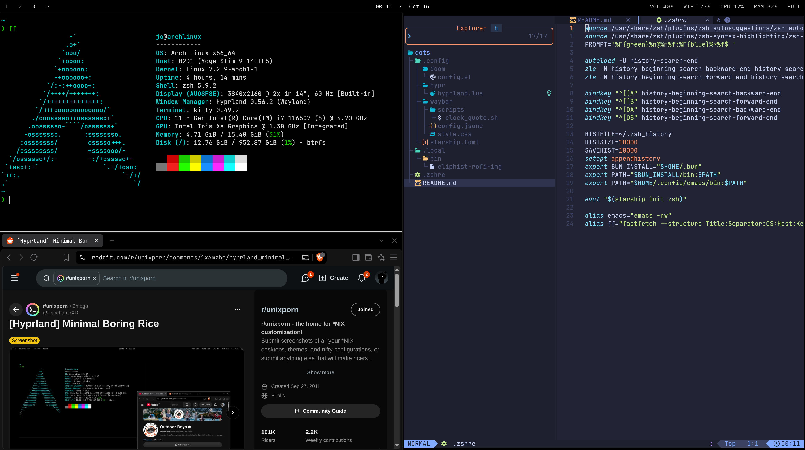

# Arch Hyprland Dots - Minimal

## Hello
These are my personal dots which work for me on my devices. If something doesn't work on your end, investigate and modify as you'd like.

## TODO
- DOOM Emacs
- LazyVim
- Starship

## Packages
### Official Repos
<!-- pacman -Qneq -->
base
base-devel
bluez
bluez-utils
brightnessctl
btop
btrfs-progs
cliphist
cups
cups-pk-helper
discord
discount
dolphin
dunst
efibootmgr
emacs
fastfetch
fd
firefox
foot
fuzzel
ghostscript
git
gst-plugin-pipewire
htop
hyprland
hyprpaper
hyprpicker
hyprpolkitagent
hyprshot
impala
intel-media-driver
intel-ucode
iwd
kitty
kvantum
less
libpulse
libva-intel-driver
libvpl
limine
linux
linux-firmware
ly
mkinitcpio
nano
neovim
networkmanager
noto-fonts
noto-fonts-cjk
noto-fonts-emoji
nwg-look
obs-studio
openssh
pipewire
pipewire-alsa
pipewire-jack
pipewire-pulse
polkit-kde-agent
power-profiles-daemon
qt5-wayland
qt6-wayland
qt6ct
rofi
satty
shellcheck
smartmontools
snapper
sof-firmware
starship
steam
sudo
system-config-printer
terminus-font
ttf-dejavu
ttf-jetbrains-mono-nerd
ttf-liberation
ttf-nerd-fonts-symbols-mono
ufw
uwsm
vim
vlc
vlc-plugins-all
vpl-gpu-rt
vulkan-intel
vulkan-nouveau
vulkan-radeon
waybar
wget
wireplumber
wl-clipboard
wofi
xdg-desktop-portal-hyprland
xdg-desktop-portal-kde
xdg-utils
xf86-video-amdgpu
xf86-video-ati
xf86-video-nouveau
zram-generator
zsh
zsh-autosuggestions
zsh-syntax-highlighting

### AUR
<!-- pacman -Qmeq -->
brave-bin
yay
yay-debug
